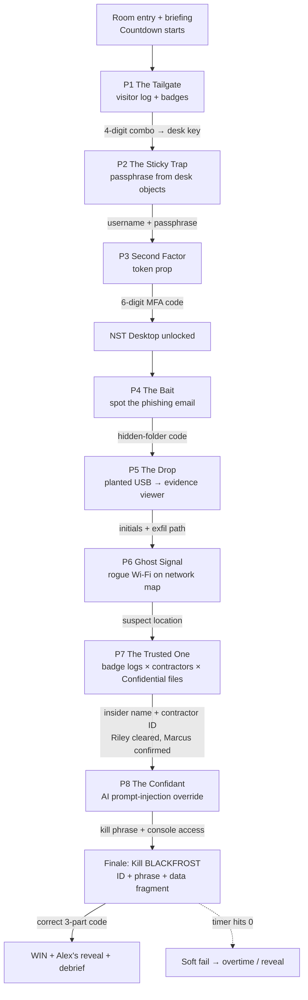

# 05 — High-Level Architecture

> How the **physical room**, the **web terminal**, and the **real files** connect into one coherent,
> resettable system. This is the technical blueprint that Phase 3 will build.

---

## 1. System components

```
┌──────────────────────────────────────────────────────────────────────────────┐
│                              THE ROOM (physical)                               │
│   Locks · lockbox · drawer · binders · envelopes · posters · USB · UV torch    │
│   token prop · badges · visitor log                                            │
└───────────────┬────────────────────────────────────────────────┬──────────────┘
                │ outputs codes/keys                               │ inputs codes
                ▼                                                  ▼
┌──────────────────────────────────────────────────────────────────────────────┐
│                         WINDOWS HOST (the chassis)                             │
│   • Auto-login local account  • Branded wallpaper  • Kiosk browser on boot     │
│   • Real artifact folders:  \Evidence  \NIMBUS_USB  \Logs                       │
│   • reset.bat (restores artifacts + relaunches kiosk)                          │
└───────────────┬───────────────────────────────────────────────┬───────────────┘
                │ launches                                        │ serves files to
                ▼                                                 ▼
┌──────────────────────────────────────────────────────────────────────────────┐
│              NIMBUS SECURE TERMINAL — local web app (the soul)                 │
│   login → mfa → desktop → mail → files → network → assistant → killswitch      │
│   state.js (progress)   ·   content/ (emails, logs, clues)   ·   reset hook    │
└──────────────────────────────────────────────────────────────────────────────┘
                                   │
                                   ▼  mirrored to
                        ┌──────────────────────────┐
                        │  2nd display / projector  │
                        │  BLACKFROST countdown ⏱   │
                        └──────────────────────────┘
```

**Three layers, one experience:** the **room** feeds codes into the **web app**; the **web app**
hands off to a few **real files** when forensic realism matters; the **host** ties it together and
makes reset a single action.

---

## 2. The lock-and-key dependency graph

Each node is a "gate"; each edge is the key that opens it. This is what guarantees a strict,
unskippable order while still allowing the middle to be worked in parallel.



---

## 3. Physical ↔ digital handoff map

The room and the web app are deliberately interleaved. This table is the contract between them.

| Step | Physical side produces… | …consumed by the web app as | Web app then reveals… |
|---|---|---|---|
| P1 | Lockbox combo (from visitor log) | *(opens physical lockbox)* | desk key (physical) |
| P2 | Passphrase words (desk objects) | text typed into `login.html` | MFA prompt |
| P3 | 6-digit code (token prop) | text typed into `mfa.html` | `desktop.html` |
| P4 | — | players read `mail.html` | folder code → used in `files.html` |
| P5 | USB found in room | `\NIMBUS_USB` shown in evidence viewer | initials + exfil path |
| P6 | Rogue SSID on poster/survey | matched in `network.html` | suspect location |
| P7 | Badge-log + contractor binders + Confidential folder | confirmed against `files.html` CSV | insider ID fragment |
| P8 | Alex's override phrase (found earlier) | typed into `assistant.html` | kill-switch console + phrase |
| Finale | All fragments | entered in `killswitch.html` | WIN / FAIL |

---

## 4. The web app internals (implemented in Phase 3)

```
NIMBUS-Secure-Terminal/
├─ index.html            → redirects to login (kiosk entry point)
├─ login.html            → Puzzle 2 gate
├─ mfa.html              → Puzzle 3 gate
├─ desktop.html          → hub: links to mail/files/network/assistant + countdown
├─ mail.html             → Puzzle 4 (inbox: 1 phish + several legit)
├─ files.html            → Puzzles 4–7 (classified browser, hidden folder, badge CSV viewer)
├─ network.html          → Puzzle 6 companion (map + Wi-Fi survey)
├─ assistant.html        → Puzzle 8 (scripted, prompt-injected bot)
├─ killswitch.html       → Finale (countdown + 3-fragment code entry)
├─ win.html / fail.html  → endings
├─ assets/
│  ├─ css/nimbus.css     → the corporate theme (logo, colors, fonts)
│  ├─ js/state.js        → progress tracking, timer, gates, host controls
│  └─ js/config.js       → answers and editable on-screen content
└─ timer.html            → optional standalone room/tablet countdown
```

**Key design choices:**
- **Single source of truth for answers:** all codes/passphrases live in `assets/js/config.js` so you
  can re-theme or change numbers in one place (great for running variants across the month).
- **Client-side only:** no backend needed; checks happen in each puzzle page using shared config/state. (Optional local server only
  for clean URLs / the optional local-LLM bot.)
- **Progress + reset:** `state.js` stores progress in `sessionStorage`; a host **reset hotkey**
  (`Ctrl+Alt+R`) clears it and returns to `index.html`.

---

## 5. Real-file artifacts on the Windows host

Only the artifacts that *benefit* from being "real" live outside the web app:

| Path | Artifact | Used by | Why real |
|---|---|---|---|
| `C:\NIMBUS\Live\Evidence\parking_lot_metadata.txt` | Fallback metadata record (optional real photo can replace it) | P5 | Preserves the clue without requiring EXIF tooling |
| `C:\NIMBUS\Live\NIMBUS_USB\…` | The USB's harmless `loader.txt` and `exfil_list.csv` | P5 | Plugging in a real USB is tactile |
| `C:\NIMBUS\Live\Evidence\badge_access.csv` | Badge access records | P7 | Can be opened in a real app for realism (also mirrored in web app) |
| `C:\NIMBUS\Wallpaper\nimbus.png` | Branded desktop wallpaper | ambience | Sells the "real corporate PC" feel |

Everything here is **fictional and harmless** — no executables, no real data.

---

## 6. Reset architecture (built-in from day one)

Resetting is a first-class feature, not an afterthought:

```
reset.bat  (host double-clicks between groups)
   1. Kill browser
   2. robocopy  _MASTER\Evidence   → C:\NIMBUS\Live\Evidence   (/MIR)
   3. robocopy  _MASTER\NIMBUS_USB → C:\NIMBUS\Live\NIMBUS_USB (/MIR)
   4. Clear web app sessionStorage (relaunch kiosk at login.html)
   5. (host re-arms physical props per Phase 5 checklist)
```

- **Digital reset:** instant (re-launch + clear storage).
- **File reset:** `robocopy /MIR` from the pristine `_MASTER` copies.
- **Physical reset:** ~5 min checklist (relock lockbox, reseal envelope, re-tape USB, reset combos).

Target **total turnaround ≤ 10 minutes** between back-to-back groups.

---

## 7. Failure modes & safeguards

| Risk | Safeguard |
|---|---|
| Player closes/breaks the kiosk browser | Kiosk auto-relaunch on close; host reset hotkey |
| Team hard-stalls on a puzzle | 3-tier hint ladder (Phase 5) + sealed MFA-recovery envelope |
| USB removed/lost | Spare USBs in host kit; contents also viewable in web app as fallback |
| Wrong codes entered repeatedly | Web app shows gentle "access denied" + nudges, never hard-locks |
| Countdown reaches zero | Theatrical **soft fail** → host grants overtime or reveals solution |
| Next group sees old progress | `state.js` reset + `reset.bat` guarantee a clean slate |

---

## 8. Build order for later phases (preview)

1. **Phase 2** finalizes the *content* of every gate (exact codes, emails, logs, passphrase, kill code).
2. **Phase 3** implements this architecture: the web app folder, the Windows host config, real
   artifacts, and `reset.bat`.
3. **Phase 4** produces the *printables* that feed the physical side of the handoff map (§3).
4. **Phase 5** delivers the operational layer: host script, reset checklist, hint ladder, facilitator
   guide.

---

### Architecture summary

A **themeable web app** carries the story and all the gating; the **Windows host** provides realism
and a one-action reset; **a few real files** add tactile "this is a real computer" payoffs; and a
**strict lock-and-key graph** keeps the 8-puzzle chain unskippable while letting the investigative
middle be solved collaboratively. It's immersive, safe, offline, and built to run many times across
Security Awareness Month.
